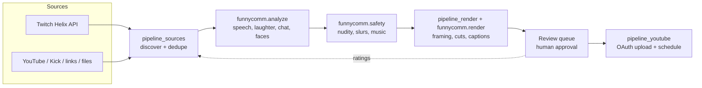

<p align="center">
  
</p>

<h1 align="center">FunnyComm Twitch Pipeline</h1>

<p align="center">
  
  
  
  
  
</p>

An end-to-end desktop pipeline that finds the funniest moments on Twitch, edits them into vertical Shorts and longer YouTube compilations, and gets them ready for upload. Every video is reviewed by a human before anything is posted.

It listens for laughter, reads stream chat, transcribes the dialogue, frames the people on screen, screens for unsafe content and learns from your review choices. Every analysis model runs **locally and offline**.

## Features

### Finding clips
- **Twitch Helix API discovery** across a rolling window, searched in 7-day blocks so top clips don't hide older moments
- **Crowd signal:** how many different viewers clipped the same seconds, and what they called it
- **Full-stream scanning:** listens through a whole broadcast to cut moments nobody clipped
- **More sources:** YouTube, Kick, pasted links, local files and watched folders (Drive, Dropbox)
- **Duplicate protection:** audio fingerprints recognise the same moment after re-encoding, cropping or re-clipping, and SHA-256 indexing skips files you already have

### Understanding what's funny
- **Laughter, scream and crowd tagging** with a CED audio-tagging model ([sherpa-onnx](https://github.com/k2-fsa/sherpa-onnx))
- **Speech transcription** with [faster-whisper](https://github.com/SYSTRAN/faster-whisper) (distil-large-v3.5), so cuts include the setup *and* the punchline
- **Stream-chat reading** with OCR (RapidOCR): spots reactions like "LMAO" and "AYOOO"
- **Learns your taste:** star ratings outrank every automatic signal, and categories you keep skipping move down the list

### Editing
- **Smart vertical framing:** two looks that take turns (square, or full-screen with split people stacked), so you can A/B test what performs better
- **Webcam-aware gaming layouts** using the [Streamer Shorts Studio](https://github.com/HishamKhan1/streamer-shorts-studio) reframing engine
- **Face detection** with OpenCV YuNet. It never opens on a cut-off face
- **Cuts built around the payoff** that never start or stop mid-word
- **Restrained motion:** at most one or two reaction push-ins, at the biggest moment
- **Always-on captions** with one emoji, audio normalised to -14 LUFS, 1440×2560 at 60 fps output
- **Long-form compilations** from a plain-English idea ("best of last week"): scene ordering, chapters, thumbnails, titles and description

### Safety and publishing
- **Content screening:** nudity detection (NudeNet), slur and risky-word flags with timestamps, music hints, copyright-muted moments skipped
- **Human review queue:** watch, then approve or skip with keyboard shortcuts. Approve stays locked until you've watched the clip
- **YouTube Data API v3 upload** with your own OAuth sign-in, scheduled posting of approved Shorts, and custom thumbnails retried after processing
- **Reliability:** daily database backups, copy-then-verify for every file, stop button, retries and interrupted-upload protection

## Architecture



## Getting started

**Requirements:** Windows 10/11, Python 3.12 (64-bit, with the `py` launcher), FFmpeg.

1. Clone the repo:
   ```powershell
   git clone https://github.com/HishamKhan1/funnycomm-twitch-pipeline.git
   cd funnycomm-twitch-pipeline
   ```
2. Run **`Install_Pipeline.bat`**. It creates `.pipeline_venv` and installs `requirements.txt`.
3. Run **`Install_Smart_Editing.bat`** for speech, laughter, chat reading and the nudity scan. It downloads the speech model once (about 1.5 GB).
4. Add the offline models listed in [`models/README.md`](models/README.md).
5. Start with **`Launch_Pipeline.bat`**, then connect Twitch and YouTube in Settings.

### API setup
- **Twitch:** create an app at [dev.twitch.tv/console/apps](https://dev.twitch.tv/console/apps) with the redirect URI `http://localhost:8765/callback`, then paste its Client ID and Secret into Settings.
- **YouTube:** create a Google Cloud project, enable YouTube Data API v3, create a *Desktop* OAuth client and select its JSON in Settings. Credentials stay in `Pipeline_Data/` on your PC, which is excluded from git.

### Tests
```powershell
.\Self_Test.bat
```
Runs 86 offline tests in a throw-away folder. Your data isn't touched.

## Project structure

| Path | What it does |
|---|---|
| `Pipeline_App.py` | Tkinter desktop app: Home, Review, Get clips, Settings |
| `pipeline_simple.py` | Simplified "Shorts first" home screen |
| `pipeline_core.py` | Settings, database, Twitch client, file handling |
| `pipeline_sources.py` | Clip sources: Twitch, YouTube, Kick, links, folders |
| `pipeline_render.py` | Render orchestration and quality checks |
| `pipeline_youtube.py` | YouTube OAuth, upload, scheduling, thumbnails |
| `Pipeline_Headless.py` | Headless runner for the optional daily scheduled task |
| `funnycomm/` | Smart-editing engine: analysis, framing, captions, safety, long-form |
| `engine/` | Webcam detection and reframing (from Streamer Shorts Studio v2.4.2) |
| `tests/` | Offline test suite |

## Responsible use

FunnyComm is built around permission and review. Only use clips you have the rights or the streamer's permission to repost. The safety screen and music hints help, but they aren't a guarantee: watch every video before it goes out. Reframing alone may not count as transformative under YouTube's reused-content policy, so adding original commentary is recommended.

## Version history

| Version | Highlights |
|---|---|
| 0.8.0 | Square and full-screen looks take turns, always-on caption, rare reaction zooms, picks that learn from Review |
| 0.7.0 | Steady tripod-style framing, original-broadcast quality, 1440p output, many more clip sources |
| 0.6.0 | "Shorts first" redesign, per-streamer picks, scheduled posting after approval, free-space tool |
| 0.5.0 | Long-form YouTube videos from a plain-English idea, crowd and laughter signals, YouTube sign-in |
| 0.4.0 | Smart editing: one 60 fps pass, webcam anywhere, safety screening, audio fingerprint duplicates |
| 0.3.0 | 60-day discovery in weekly blocks, skip-lists and existing-clip hashing |
| 0.2.0 | Optional public-clip downloader for permitted campaigns |
| 0.1.0 | Twitch discovery, reframing, review queue, private YouTube upload |
